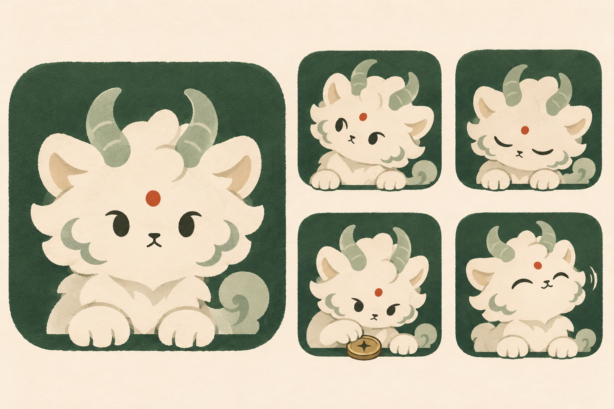

# 知几桌面端 1:1 改造方案 · 第一版

以本机安装的 Linger 为视觉和交互基准，在知几现有 Electron 应用里独立实现。窗口结构、留白、消息气泡、悬停反馈和表情反应都跟随参考。原创视觉集中在一个地方：知几的主宠物阿几。用户打开应用时，先感到聊天顺手，再在鼠标经过头像的那一刻认识它。

阿几的第一版设定图已经画好。左侧是主头像，右侧依次是侧望、眨眼、拨盘、抬头回应。这张图作为后续绘制动画帧的角色母版。

高清文件：`docs/design/阿几角色设定-v1.png`

本版交付的是改造方案和原创角色设定图。界面代码与可播放动画属于实施阶段。

## 一、界面怎么做到 1:1

还原时最容易失真的，是每样东西看起来都差不多，放在一起却不像。截图里尤其值得保留的是三处关系：左侧选中会话的深绿色只占一小块；右侧对话留有很宽的呼吸空间；底部输入框与消息正文共用左右边界。先用同尺寸窗口叠图确定这些位置，再处理图标和圆角。

| 区域 | 知几的改造规格 |
| --- | --- |
| 窗口与导航 | 对齐 macOS 红黄绿按钮、顶部工具栏、左侧窄导航和白色内容面板。顶部居中的会话胶囊显示阿几头像与「知几」，群聊时换成员头像组合。 |
| 会话列表 | 搜索框、置顶卡片、分组标题、右侧加号按参考定位。选中会话整卡变深绿。阿几使用圆角方形头像，两行文字分别显示名称和最后一条消息摘要。 |
| 消息区 | 用户消息靠右，用近黑色气泡和白字；角色消息靠左，用浅灰气泡和深色字。角色名、头像、日期分隔、短句气泡宽度都按参考测量。用「晚上好」和一段长中文分别校准，避免短句显空、长句每行过满。 |
| 输入区 | 还原悬浮白色输入框、细描边、轻阴影和底部工具行。模型标签显示实际使用的本地模型或 API 模型。知几已有的「请两位参看」收进加号菜单，`@紫微`、`@奇门` 可在输入框直接完成。 |
| 头像与设置 | 一并对照首次进入、设置头像、头像裁切、私聊切换、群成员选择，以及设置弹窗打开与关闭。知几沿用独立本机身份。参考图中的麦克风若要出现，应与可用的录音功能一同交付。 |

还原基准分两次取样。静态基准用相同窗口尺寸、显示缩放和测试消息截图；动态基准在本机 Linger 录下悬停、移出、贴表情和切换会话。单张截图无法确定动画时长、悬停热区或点击后的行为，这些细节以实机为准。实现使用知几自己的代码、图标和角色资产。

## 二、阿几的形象与动作定稿

阿几是一只守盘的小白泽。暖白卷毛，两只青瓷色短角，眉心一点朱砂，两只前爪自然搭在头像下沿。它平时安静，察觉有人靠近时先动眼睛，脑袋总慢半拍。这个「慢半拍」就是它的性格，也是整套动作里最值得做好的细节。

头像分两种精度。置顶卡片里的大头像保留脸颊卷毛、前爪和星盘；消息旁的小头像放大脸部，保住双角、眼睛、红点。每个尺寸单独检查，尤其要避免缩小后双角和松绿背景糊成一块。

| 触发 | 阿几的动作 |
| --- | --- |
| 鼠标第一次进入头像 | 眼睛先朝指针方向挪一点，约 100 毫秒后脑袋跟过去，最多偏约 5°。前爪留在原位，像是趴着偷偷看你。 |
| 指针停住或移开 | 停住片刻，阿几慢眨一次眼。移开时眼睛先回正，脑袋随后缓缓归位。反复划过头像不会叠加或连续重播。 |
| 用户发送消息 | 阿几轻点一下头，表示消息已收到。只有当前会话正在工作的那一只播放，历史消息里的几十个头像保持安静。 |
| 正在起盘 | 阿几低头，左爪把小铜盘轻拨一格，接着安静看盘。等待较长时偶尔轻眨眼，让用户看得出应用仍在工作。 |
| 回复开始出现 | 收到首段正文时，它抬头、收爪，回到正面。动作由真实回复事件触发，因此即使模型很慢，也不会提前演出「答完了」。 |
| 收到轻松的确认或感谢 | 眼睛弯一下，点头一次。模型离线或请求失败时则轻轻歪头，由旁边的文字说明原因和重试方式。 |

动效全部在本地播放。设定图拆成头、眼睑、瞳孔、前爪、铜盘几层，眼神跟随用位移，眨眼和拨盘用手绘关键帧。不同动作之间可以自然衔接，也不需要为每次表情调用模型。系统开启「减少动态效果」时，改用静态姿态切换。

设定图五格，从左到右、从上到下：

1. 主头像：正面趴姿，双角、朱砂、前爪搭在下沿，尾在右侧。
2. 侧望：眼睛看向一侧。
3. 眨眼：双眼轻轻合上。
4. 拨盘：左爪按在小铜盘上。
5. 抬头回应：眼睛弯起，带一点点头的动势。

## 三、表情和等待诗句怎么融进聊天

表情要能回应某一句具体的话。例如用户补充「刚才说的是下个月那场考试」，阿几可以在这条补充消息右下角贴一个 👌，随后按修正后的月份回答。用户重开会话时，表情仍在原来的气泡上。

- 用户给消息贴表情：鼠标移到气泡上，旁边出现表情、复制和更多操作；移到工具条上时工具条保持可用。点选后，反应贴在气泡边缘，不挤动正文。键盘聚焦也能打开。
- 阿几给消息贴表情：首版只用于确认、感谢、收到更正等明确场景。涉及考试成败、关系困扰或模型报错时，优先用文字回应。反应与消息 ID 绑定，失败重试不会贴两次。
- 等待诗句按发言者显示：知几用「一灯照两卷，细处见端倪」；紫微用「十二宫中寻旧曜，一轮岁次看星移」；奇门用「一局随时起，八门待次开」。诗句只占当前角色气泡里的一行，首段正文抵达就自然替换。模型下载和连接失败则显示真实进度或错误。

## 四、实施顺序与验收

第一步，做一段可以直接和 Linger 并排比较的私聊。固定用「晚上好」、一条长消息和一条带 👌 的补充消息。先对齐空闲、选中、悬停、输入四种画面。在 1280×820 和 1440×900 两个窗口尺寸各验一次，主要边界以逻辑像素测量，目标误差控制在约 2 像素内。

第二步，接入阿几和真实消息事件。做出大、小两套头像和六个动作，接到发送、起盘、首段回复、完成及失败。重点检查快速移入移出、等待时切换会话、模型中途失败、重试、减少动态效果这五种情况。

第三步，扩展到分身、群聊和设置。验证三位角色按顺序发言时，头像、诗句、消息反应都跟对人；切换命主或重启应用后，消息与表情仍属于原会话。最后再录一段与 Linger 同操作、同窗口尺寸的视频，对照动态细节。

这版最重要的验收场景是：鼠标靠近，阿几抬眼看你；发出问题，它低头拨盘；正文出现，它抬头；你补充一句，它把 👌 轻轻贴在那一句上。
